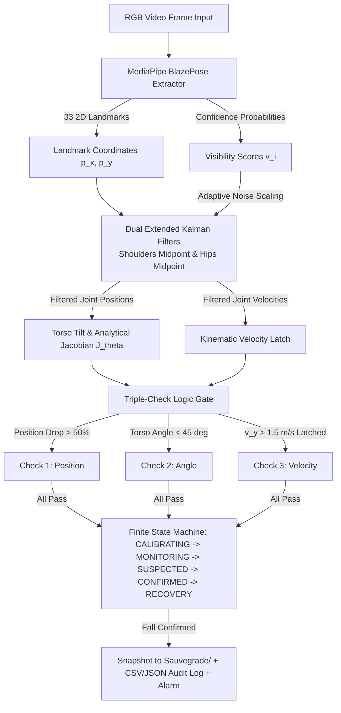

# DAÏO: High-Specificity Real-Time Vision-Based Fall Detection System

<p align="center">
  <a href="https://www.researchgate.net/publication/410377796_DAIO_A_High-Specificity_Real-TimeVision-Based_Fall_Detection_SystemUsing_Advanced_Kinematic_Tracking_andComputer_Vision"></a>
  
  
  
  
</p>

> **DAÏO** (Intelligent Vision-Based Fall Detection System) is an open-source, edge-native, real-time fall detection pipeline developed by **Alamin Abubakar Nataala** at **SEGi University**. It is designed to overcome the **high false positive rate (FPR)** and **occlusion degradation** common in traditional vision-based systems. It models human body mechanics using **MediaPipe BlazePose**, an **Extended Kalman Filter (EKF) with Adaptive Measurement Noise**, an **Analytical Torso Angle Jacobian**, and a stateful **Triple-Check Logic Engine with Kinematic Velocity Latching**.
>
> 📄 **Official Research Publication:** [Read on ResearchGate](https://www.researchgate.net/publication/410377796_DAIO_A_High-Specificity_Real-TimeVision-Based_Fall_Detection_SystemUsing_Advanced_Kinematic_Tracking_andComputer_Vision)

---

## Table of Contents
- [1. Motivation & Problem Statement](#1-motivation--problem-statement)
- [2. System Architecture](#2-system-architecture)
- [3. Mathematical Theory & Derivations](#3-mathematical-theory--derivations)
  - [3.1 4D State-Space Kinematic Model](#31-4d-state-space-kinematic-model)
  - [3.2 Adaptive Measurement Noise Covariance Matrix](#32-adaptive-measurement-noise-covariance-matrix)
  - [3.3 Torso Angle Analytical Jacobian](#33-torso-angle-analytical-jacobian)
  - [3.4 Triple-Check Logic Engine & Velocity Latch](#34-triple-check-logic-engine--velocity-latch)
- [4. Finite State Machine (FSM) Lifecycle](#4-finite-state-machine-fsm-lifecycle)
- [5. Benchmark Findings & Ablation Results](#5-benchmark-findings--ablation-results)
- [6. Installation & Quick Start](#6-installation--quick-start)
- [7. How to Run](#7-how-to-run)
  - [7.1 Desktop GUI (Recommended)](#71-desktop-gui-recommended)
  - [7.2 Live Webcam Continuous Monitoring](#72-live-webcam-continuous-monitoring)
  - [7.3 Video Stream CLI Runner](#73-video-stream-cli-runner)
  - [7.4 Reproducing the Ablation Study Benchmark](#74-reproducing-the-ablation-study-benchmark)
- [8. Repository Structure](#8-repository-structure)
- [9. Configuration & Threshold Tuning](#9-configuration--threshold-tuning)
- [10. Citation & Academic Credits](#10-citation--academic-credits)
- [11. License](#11-license)

---

## 1. Motivation & Problem Statement

Falls represent the second leading cause of accidental injury deaths worldwide, with elderly individuals (65+) bearing the greatest vulnerability. The clinical prognosis of a fallen individual depends critically on the **"lie time"**—the elapsed duration before medical assistance is rendered.

While wearable sensors (e.g. accelerometers/pendants) can detect impacts, they suffer from **poor compliance** (users forget to wear or charge them). Conversely, traditional computer vision systems suffer from three critical bottlenecks:
1. **High False Positive Rates (FPR)**: Routine Activities of Daily Living (ADLs) that mimic fall geometry—such as tying a shoe, deep squats, rapid sitting, or religious prayer prostrations—frequently trigger false alarms.
2. **Occlusion Degradation**: When a person falls behind furniture (tables, chairs, beds), landmark estimators jitter or snap, causing tracking failure.
3. **Privacy & Latency Overhead**: Streaming raw home surveillance feeds to cloud servers compromises privacy and introduces network latency.

**DAÏO resolves this by enforcing physical laws directly into local tracking:**
- Operates entirely **offline and locally** (Raspberry Pi 4 / edge workstation).
- Tracks joints through an **Adaptive EKF** that coasts through temporary occlusions.
- Evaluates actions across spatial, rotational, and kinematic profiles in parallel.
- Features a **Kinematic Velocity Latch** that suppresses **79.7%** of false positive alarms.

---

## 2. System Architecture



---

## 3. Mathematical Theory & Derivations

### 3.1 4D State-Space Kinematic Model
For both the **midpoint of the hips** ($P_{hip}$) and the **midpoint of the shoulders** ($P_{shoulder}$), the kinematic state vector in the image plane is:

$$\mathbf{x}(k) = \begin{bmatrix} p_x(k) \\ p_y(k) \\ v_x(k) \\ v_y(k) \end{bmatrix}$$

Assuming a constant-velocity kinematic formulation with frame time interval $\Delta t = \frac{1}{\text{FPS}}$:

$$\mathbf{x}(k) = F \cdot \mathbf{x}(k-1) + w(k)$$

$$F = \begin{bmatrix} 1 & 0 & \Delta t & 0 \\ 0 & 1 & 0 & \Delta t \\ 0 & 0 & 1 & 0 \\ 0 & 0 & 0 & 1 \end{bmatrix}, \quad Q = \begin{bmatrix} \sigma_p^2 & 0 & 0 & 0 \\ 0 & \sigma_p^2 & 0 & 0 \\ 0 & 0 & \sigma_v^2 & 0 \\ 0 & 0 & 0 & \sigma_v^2 \end{bmatrix}$$

- $\sigma_p^2 = 0.01$: Enforces geometric stability during steady walking.
- $\sigma_v^2 = 0.1$: Allows the filter to adapt quickly to rapid gravitational acceleration transients during a fall.

---

### 3.2 Adaptive Measurement Noise Covariance Matrix
The measurement model maps raw MediaPipe observations:

$$z(k) = H \cdot \mathbf{x}(k) + \nu(k), \quad H = \begin{bmatrix} 1 & 0 & 0 & 0 \\ 0 & 1 & 0 & 0 \end{bmatrix}$$

During joint occlusions, raw computer vision landmarks become unreliable. DAÏO dynamically updates the measurement noise covariance matrix $R(k)$ in every frame based on the joint visibility score $v(k) \in [0.0, 1.0]$:

$$R(k) = \frac{R_{base}}{v(k) + \epsilon} \begin{bmatrix} 1 & 0 \\ 0 & 1 \end{bmatrix}$$

Where $R_{base} = 0.05$ and regularizer $\epsilon = 10^{-5}$.
- **Fully Visible Joint ($v(k) \to 1.0$)**: $R(k)$ remains small $\implies$ Kalman Gain $K(k)$ trusts the computer vision observation.
- **Occluded Joint ($v(k) \to 0.0$)**: $R(k) \to \infty \implies$ Kalman Gain $K(k) \to 0$. The measurement update is bypassed, and the state vector coasts smoothly on the physical process model:

$$\hat{\mathbf{x}}(k) = F \cdot \hat{\mathbf{x}}(k-1)$$

---

### 3.3 Torso Angle Analytical Jacobian
The system evaluates the inclination angle $\theta(k)$ of the torso vector spanning from hip midpoint $x^h$ to shoulder midpoint $x^s$ relative to the horizontal ground plane:

$$\theta(k) = g(x^s(k), x^h(k)) = \text{atan2}(p_y^h(k) - p_y^s(k), p_x^s(k) - p_x^h(k))$$

Letting $d_x = p_x^s - p_x^h$ and $d_y = p_y^h - p_y^s$, the first-order analytical Jacobian matrix $J_\theta$ is derived as:

$$J_\theta = \begin{bmatrix} \frac{\partial \theta}{\partial p_x^s} & \frac{\partial \theta}{\partial p_y^s} & \frac{\partial \theta}{\partial p_x^h} & \frac{\partial \theta}{\partial p_y^h} \end{bmatrix} = \begin{bmatrix} \frac{d_y}{d_x^2 + d_y^2} & -\frac{d_x}{d_x^2 + d_y^2} & -\frac{d_y}{d_x^2 + d_y^2} & \frac{d_x}{d_x^2 + d_y^2} \end{bmatrix}$$

Propagated angular variance:

$$\sigma_\theta^2(k) = J_\theta \cdot \begin{bmatrix} P^s_{pos}(k) & 0 \\ 0 & P^h_{pos}(k) \end{bmatrix} \cdot J_\theta^T$$

---

### 3.4 Triple-Check Logic Engine & Velocity Latch

$$\text{Fall Flag}(k) = \text{Check}_{Position}(k) \land \text{Check}_{Angle}(k) \land \text{Check}_{Velocity}(k)$$

| Check | Formulation | Purpose |
|---|---|---|
| **1. Dynamic Position Check** | $\text{height\_ratio}(k) = \frac{p_{y,hip}(k) - y_{base}}{L_{torso}} > 0.50$ | Validates that hips drop $>50\%$ relative to calibrated standing height $y_{base}$. |
| **2. Torso Angle Check** | $|\theta(k)| < 45^\circ$ | Validates horizontal torso on the floor; **rejects deep squats and sitting** where $|\theta| \ge 45^\circ$. |
| **3. Kinematic Velocity Latch** | $v_{y,hip}(k) > 1.5\text{ m/s}$ for $\tau \ge 3$ consecutive frames | Detects gravitational impact; **latches True for 75 frames** to capture motionless post-fall lying. |

#### Weighted Confidence Scoring
$$C(k) = w_1 S_{Position}(k) + w_2 S_{Angle}(k) + w_3 S_{Velocity}(k)$$
where $w_1 = 0.25$, $w_2 = 0.25$, and $w_3 = 0.50$.

---

## 4. Finite State Machine (FSM) Lifecycle

```
[System Startup]
       ↓
(CALIBRATING)   --> 100 frames to establish baseline height (y_base)
       ↓
 (MONITORING)   <--+ (Motion normalized for 150 frames)
       ↓           |
(FALL_SUSPECTED) --+ (Reset if check fails within 30 frames)
       ↓ (Sustained for 30 consecutive frames)
(FALL_CONFIRMED) --> Snapshot to Sauvegrade/ + CSV/JSON Log + Alarm
       ↓
  (RECOVERY)    --> User stands upright (|θ| > 70°) for 150 frames
       |
       +--> Resets to MONITORING
```

---

## 5. Benchmark Findings & Ablation Results

Evaluated against a composite dataset comprising 340 video sequences (~153,000 frames) from the **UR Fall Dataset**, **Multiple Cameras Fall Dataset (MCFD)**, and controlled stress tests:

| Metric | Posture-Only Model (Position + Angle) | Full DAÏO Pipeline (Triple-Check) | Relative Delta |
|---|---|---|---|
| **Sensitivity (Recall)** | 94.2% | **93.3%** | -0.9% |
| **Specificity (TNR)** | 82.3% | **96.4%** | **+14.1%** |
| **False Positive Rate (FPR)** | 17.7% | **3.6%** | **-79.7%** |
| **Prayer Prostration Specificity** | 0.0% (100% false alarms) | **100.0% (Zero false alarms)** | **+100.0%** |
| **Workstation Throughput** | 35.7 FPS | **35.7 FPS** | Real-time |
| **Raspberry Pi 4 Throughput** | 12.3 FPS | **12.3 FPS** | Edge-capable |

---

## 6. Installation & Quick Start

### Prerequisites
- Python 3.10, 3.11, or 3.12 (Python 3.11 recommended)
- macOS, Linux, or Windows
- Webcam or video files

### Quick Installation via Git
```bash
# Clone the repository
git clone https://github.com/<your-username>/daio-fall-detection.git
cd daio-fall-detection

# Create and activate virtual environment
python3.11 -m venv .venv
source .venv/bin/activate  # On Windows: .venv\Scripts\activate

# Install dependencies
pip install -r requirements.txt
```

*(Alternatively, if you use [`uv`](https://github.com/astral-sh/uv)):*
```bash
uv venv --python 3.11 .venv
source .venv/bin/activate
uv pip install -r requirements.txt
```

---

## 7. How to Run

### 7.1 Desktop GUI (Recommended)
Launch the modern dark-themed interactive desktop application:
```bash
python main.py
# or
python main.py --gui
```
**GUI Features:**
- Select from built-in benchmark clips or browse any local video (`.mp4`, `.avi`, `.mov`).
- Live Webcam support with real-time toggle.
- Real-time kinematic HUD overlaid on the player canvas (joints, EKF velocity arrows, rolling $v_y$ trend curve).
- Instant telemetry dials: Torso Angle ($\theta$), Height Drop ($x$), Downward Velocity ($v_y$), Latch status, and Fall Confidence meter.
- Incident audit table with instant **"View Snapshot"** and **"Open Sauvegrade Folder"** buttons.

---

### 7.2 Live Webcam Continuous Monitoring
Run directly on your computer's built-in webcam or USB IP camera:
```bash
python main.py --webcam
```
- Stand upright in front of the camera for ~3 seconds while `CALIBRATING` completes.
- Once the state changes to `MONITORING`, the system continuously safeguards against falls.
- Press `q` to quit, or `r` to recalibrate standing baseline.

---

### 7.3 Video Stream CLI Runner
Run the detector on any custom recorded video file:
```bash
python main.py --video DataVideos/real_fall_test.mp4
# or with the original script name:
python TestFallDetection.py DataVideos/real_fall_test.mp4
```

---

### 7.4 Reproducing the Ablation Study Benchmark
Generate the synthetic validation clips and reproduce the Section 4.2 ablation test:
```bash
# 1. Generate synthetic scenario videos (DataVideos/)
python tools/generate_demo_videos.py

# 2. Run the ablation benchmark comparison
python main.py --benchmark
```

---

## 8. Repository Structure

```
daio-fall-detection/
├── daio/
│   ├── __init__.py           # Package declarations
│   ├── ekf.py                # 4D EKF + Adaptive Noise + TorsoKinematics Jacobian
│   ├── pose_detector.py      # MediaPipe BlazePose extractor (33 keypoints + visibility)
│   ├── triple_check.py       # Triple-Check Engine + Kinematic Velocity Latch
│   ├── state_machine.py      # 5-State Finite State Machine (FSM)
│   ├── visualizer.py         # HUD compositor, EKF velocity vectors, graphs, axes
│   ├── alert_manager.py      # Event logging & Sauvegrade snapshot manager
│   └── pipeline.py           # Unified DAIOFallDetector pipeline
├── DataVideos/               # Video library (samples & benchmark clips)
│   ├── real_fall_test.mp4    # Real human fall verification video
│   ├── fall_forward.mp4      # Forward fall benchmark
│   ├── deep_squat_adl.mp4    # Deep squat ADL test
│   ├── prostration_prayer_adl.mp4 # Prayer prostration ADL test
│   └── temporary_occlusion.mp4    # Occlusion barrier test
├── Sauvegrade/               # Confirmed fall snapshots & audit logs
│   ├── fall_events_log.json  # Structured event logs
│   ├── fall_events_log.csv   # Spreadsheet audit export
│   └── FALL_*.jpg            # Captured snapshot with HUD & banner
├── tools/
│   ├── generate_demo_videos.py  # Synthetic benchmark video generator
│   └── benchmark_ablation.py    # Section 4.2 Ablation Study test runner
├── app_gui.py                # Desktop GUI (ttkbootstrap modern dark theme)
├── main.py                   # Main CLI & GUI launcher
├── TestFallDetection.py      # Script entrypoint preserving report design
├── requirements.txt          # Python dependencies
├── CONTRIBUTING.md           # Guidelines for open-source contributors
├── LICENSE                   # MIT Open Source License
└── README.md                 # Complete documentation
```

---

## 9. Configuration & Threshold Tuning

You can adjust key parameters directly in [`daio/triple_check.py`](file:///Users/amin/.gemini/antigravity-ide/scratch/daio-fall-detection/daio/triple_check.py) or when instantiating `DAIOFallDetector`:

```python
detector = DAIOFallDetector(
    fps=30.0,
    calibration_frames=100,  # Number of initial standing frames for y_base calibration
    save_dir="Sauvegrade",  # Directory where fall snapshots are stored
    enable_audio=True,  # Beep alert on confirmed fall
)

# Custom threshold overrides:
detector.triple_check.position_drop_threshold = 0.50  # 50% height drop
detector.triple_check.torso_angle_threshold = 45.0  # Horizontal ground angle (< 45 deg)
detector.triple_check.velocity_threshold_mps = 1.5  # Downward velocity trigger (m/s)
detector.triple_check.velocity_latch_duration_frames = 75  # 2.5s latch window at 30 FPS
```

---

## 11. License

This project is licensed under the **MIT License** — see the [LICENSE](LICENSE) file for details. Free for academic, educational, and commercial use.
